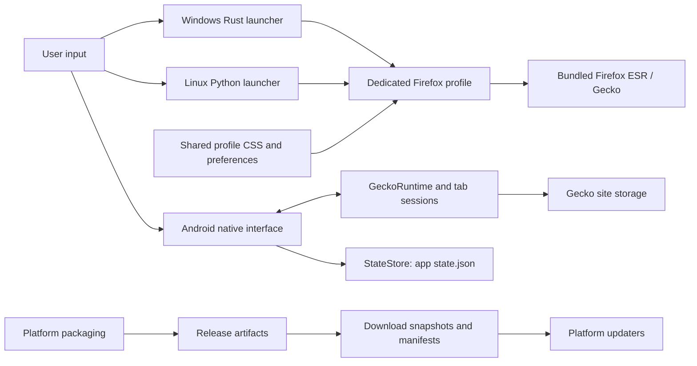
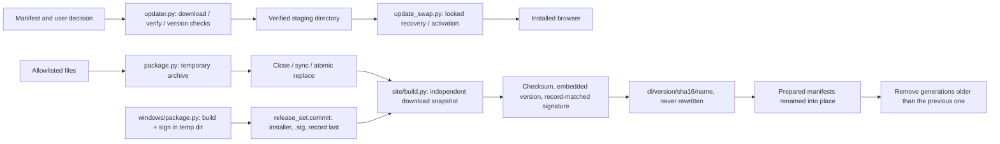

# Still Browser: architecture review and refactor

This repository contains three current platform implementations and two older
Windows clients. The highest-impact problems cross the release/update boundary,
so this refactor concentrates there. Android controller extraction and Windows
update synchronization are the next independent steps.

## Architecture and ownership

| Area | Entry point | Responsibilities and data owner |
| --- | --- | --- |
| Windows, current | `windows/launcher/src/windows.rs` | Rust launcher prepares a dedicated Firefox profile, migrates legacy Still data, checks signed updates, and starts bundled Firefox ESR. Firefox owns navigation, history, bookmarks, cookies, and passwords. |
| Linux, current | `linux/still` | Python launcher prepares a dedicated Firefox profile, applies profile migrations, checks updates, and replaces its process with bundled Firefox ESR. Firefox owns browser data. |
| Shared desktop appearance | `linux/profile/`, `windows/profile/`, `windows/firefox/` | Common CSS and initial preferences, Windows overrides, and privileged Firefox AutoConfig/settings code. These depend on Firefox's chrome and internal APIs. |
| Android, current | `android/.../MainActivity.kt` | Native views and one GeckoRuntime with lazy GeckoSessions. Activity owns app state; Gecko owns web content and site storage. `Tabs`, `Suggestions`, `Address`, and other helpers contain separately testable rules. |
| Release publication | `windows/package.py`, `windows/release_set.py`, `linux/package.py`, `site/build.py` | Build installers/archives, commit signed Windows sets, publish immutable download snapshots, and replace platform update manifests. Android is built with Gradle. |
| Windows, legacy Tauri | `desktop/` | TypeScript interface invokes guarded Rust commands; a pure Rust Session produces state/plans and the shell executes WebView2 effects. See `desktop/DESIGN.md`. |
| Windows, legacy WPF | Root `MainWindow.xaml.cs` | Older WebView2 client and PascalCase `state.json` schema. Retained for compatibility/reference. |

The current Windows and Linux clients do **not** use `desktop/core` as their
browser domain model. Moving changes into that crate alone will not improve the
currently distributed desktop apps.



The desktop profile boxes describe the same pattern on each OS, not a single
profile shared between installations.

## Main data flows

**Desktop startup and browsing.** The launcher resolves its installation and
profile, checks whether Firefox is running, applies a pending update when
possible, and prepares profile assets/preferences. Initial defaults and revision
migrations run separately from the preferences Firefox persists. Navigation and
browser history then flow directly through Firefox. Windows AutoConfig adds the
Still settings page and imports staged legacy bookmarks/history into Firefox.
Linux replaces its process with Firefox; Windows starts Firefox and exits.

**Android browsing and persistence.** Input becomes an address/search request;
the active Tab obtains a GeckoSession when needed. Gecko callbacks update tab
metadata/history and redraw the native interface. At most four live pages are
normally retained; eviction preserves in-memory session state. An immutable app
snapshot is captured on the main thread after an 800 ms debounce. One writer
thread encodes JSON and calls StateStore, which backs up unrecognized data before
using a synced temporary file and rename. Only URLs/selection are persisted for
tabs; full Gecko back/forward state is held in memory. Downloads stream Gecko
responses to MediaStore outside the UI thread.

**Release and update.** Windows' Cargo package version currently supplies the
release version for Windows, Linux, Android, and the site. The site derives size,
checksum, embedded version, and the Windows signature from one snapshot of each
file, publishes it at the immutable path `dl/<version>/<sha256[:16]>/<name>`,
and only then replaces the manifests, which name those paths. Android/Linux
read `update.json` (relative URLs, resolved against it); current and legacy
Windows clients read `update/windows.json` (absolute `https` URLs). Downloads require user action. Windows verifies the
installer's minisign signature, Android checks SHA-256 and delegates installation
to the OS, and Linux checks size/SHA-256 before staging. Linux activation retains
a newer self-updated Firefox rather than downgrading it.

## Problem areas

| Priority | Finding and evidence | Status / consequence |
| --- | --- | --- |
| P0 | Linux activation previously moved the working runtime out of the app before policy copy and directory commit, with no rollback. | Refactored into `update_swap.py`; failures at rename/policy boundaries are covered. Original runtime policy bytes, including absence, are retained for rollback. |
| P0 | `site/build.py` hard-linked public downloads to build outputs; `linux/package.py` opened the final archive with `w:gz`. | Fixed. Rebuilding could truncate already served bytes while old checksums remained published. Artifacts now replace their inode; site downloads are independent snapshots. |
| P0 | Publication was atomic only per file: fixed `dl/<name>` URLs were rewritten in place while manifests changed separately, and `update/windows.json` read each `.sig` from `artifacts/` after copying the installer. | Fixed. A concurrent rebuild could pair a new signature with an old installer (rejected by clients, but an outage) or serve new bytes under an old checksum. Signed Windows sets are committed record-last (`windows/release_set.py`); the site accepts only a record matching its snapshot, verifies the signature, publishes immutable content-addressed files, then renames prepared manifests. |
| P1 | Linux download/activation writers were unsynchronized. | Fixed for updater writers with a persistent sibling `flock`. A delayed check cannot replace a newer pending/installed version. Launcher-to-updater coordination remains a separate issue. |
| P1 | Linux packaging recursively included the whole source/runtime directory. | Fixed with an explicit release allowlist and exclusion of Firefox update downloads. Tests, old runtimes, and unrelated local files are excluded. |
| P1 | Existing `.github/workflows/desktop.yml` watches/builds the legacy Tauri tree only. | Added portable checks for current Linux, Windows customization/packaging, publication, and Rust launcher domain logic. Native Windows/Android runtime coverage is still needed. |
| P1 | `windows.rs::stage` deleted/rebuilt the update directory while `apply_staged_update` could inspect/delete/run it in another process. | Fixed in `windows/launcher/src/staging.rs`. Staging and activation hold `StillBrowser\Update.lock` (an OS file lock beside `Update`, released when the process dies). Launch only try-locks and skips activation when busy; the checker waits and re-plans under the lock, so it never replaces a newer staged or installed (registry `DisplayVersion`) version. A complete installer/signature/version set is written and synced in `Update.tmp-<pid>-<n>`, then committed by renaming the old set aside and the new one into place; leftovers are removed under the lock. |
| P1 | Android's MainActivity is approximately 1,750 lines and owns lifecycle, UI construction, engine delegates, prompts, suggestions, updates, and state scheduling. | Open. Ownership and cancellation become difficult to audit; extract controllers by effect/lifecycle boundary. |
| P2 | `Suggestions.local` asks `MainActivity.titleFor` for every candidate. That method scans history and tabs; all this runs while typing. | Potential CPU bottleneck: approximately O((tabs + bookmarks + history) × (history + tabs)) title lookup work before ranking. History is capped at 500, but tabs/bookmarks are not. Profile before changing data structures. |
| P2 | Android search suggestions use a single-thread executor with 3 s connect/read timeouts. Request IDs discard stale results but queued HTTP requests are not cancelled. | Potential latency bottleneck: the latest query can wait behind obsolete work. Use a bounded latest-request slot and cancellation/disconnection, with tests for out-of-order replies and disposal. |
| P2 | Windows downloaded a complete installer into a Vec and read it again during activation (`windows.rs`). | Fixed. The body streams to the temporary file in 64 KiB chunks with the 400 MB limit (declared length checked first). Tauri signatures are prehashed (`ED`), so `minisign-verify` 0.2's `verify_stream` checks them from the file in constant memory, at staging and again at activation (through a handle that denies writes/deletes until the installer starts). Legacy `Ed` signatures fall back to one bounded in-memory copy read from the file. |
| P2 | Release-version extraction/comparison and profile requirements are repeated across Python, Rust, and Gradle. | Open. Use shared release metadata and language-neutral fixtures. Keep OS-specific behavior in platform adapters. |

The performance findings are source-level complexity/queue analysis, not measured
latency improvements. Existing good choices include lazy tabs, bounded Android
history/download lists, streamed downloads, debounced saves, and the legacy
Tauri client's explicit domain/shell boundary. Preserve those during extraction.

## Implemented boundaries and invariants



- `updater.py` handles transport, manifest/version decisions, and notifications;
  `update_swap.py` handles filesystem activation, policy restoration, and locking.
  Both download and activation acquire the same lock outside renamed directories.
- The lock file intentionally persists: deleting it would permit writers to lock
  different inodes. Lock contention does not wait on the launcher path.
- Policy content is allocated before renaming the installation. Rollback uses
  saved policy files/absence markers rather than allocating rewritten content.
- A complete Linux archive replaces the final artifact only after successful
  close/sync. Packaging is importable and has an explicit `main()` entry point.
- Public download files are independent of mutable artifacts. Their size, digest,
  Linux version, Android metadata, and Windows signature come from one snapshot
  per file. Large files are streamed, never loaded into memory.
- A Windows set in `artifacts/` is `<installer>`, `<installer>.sig`, and the
  record `<installer>.release.json` (`file`, `size`, `sha256`, `signature`).
  `release_set.commit` renames them from a temporary directory on the same
  filesystem: old `.sig` removed, installer, `.sig`, record last. Plain-pair
  readers see a matching signature or none; record readers see the previous
  record (which no longer matches the installer) until the commit point. The
  site retries such a mismatch and fails the build if it persists.
- The site publishes a signature only when the record's size/SHA-256 equal its
  snapshot, the key ID is the updater key's (`tauri.conf.json`), the signed file
  name matches, and (with Python `cryptography`) both Ed25519 signatures verify.
- Published files live at `dl/<version>/<sha256[:16]>/<name>` (version: the
  file's embedded version, else the release version). An existing path is never
  rewritten; identical bytes keep the same URL across rebuilds. `dl/<name>` is a
  hard link to the newest file for people; manifests never name it. Nothing is
  written in place, so shared inodes are safe and cost no extra disk space.
- Manifests (`update/windows.json`, `update.json`, `index.html`) are written to
  synced temporary files first and renamed only after every file they name is
  published. Retention keeps the new generation, the previous distinct one
  (`.generations.json`), and every path named by the manifests being replaced;
  older `dl/<version>/<hash>/` folders are removed. Site builds hold a `flock`.
- Tests package tiny fixtures, extract them, and run the real launcher with
  `--prepare-only`; no production artifacts, served site, or user profiles change.

## Refactor strategy from here

1. **Finish update/publication transaction boundaries.** Publication is done:
   immutable content-addressed URLs, record-bound Windows signatures, and
   prepared manifest replacement (see invariants). Add a stable Linux outer
   launcher (or supported atomic directory exchange) for recovery after abrupt
   termination. Coordinate launch admission with activation on Linux (Windows
   now uses the same writer/commit model, `staging.rs`). Acceptance: concurrent builds/checks/launches
   always resolve complete release sets, including forced process termination.
2. **Extract Android effects without changing the saved schema.** Move remote
   suggestion requests into a cancellable controller, engine/tab callbacks into a
   session controller, and state-save scheduling into a repository. Activity keeps
   view construction and lifecycle wiring. Add ownership/disposal tests before
   moving callbacks; preserve lazy sessions and immutable save snapshots.
3. **Remove repeated work and duplicated contracts.** Benchmark address entry with
   many bookmarks/tabs, build a reusable title/visit index only if warranted, and
   cap pending suggestion work. Establish fixtures for release versions, image
   formats, and profile migrations across languages. Avoid a shared runtime layer
   that would couple Python, Rust, Kotlin, and privileged Firefox JavaScript.
4. **Align ongoing validation and repository organization.** Add Windows compile
   checks/installer smoke tests and Android JVM/device checks. Retain the legacy
   Tauri update/migration compatibility until support is intentionally retired;
   only then move legacy roots and their release jobs into an explicit archive.

## Validation and remaining limits

```sh
python3 -m unittest discover -s linux/tests -p 'test_*.py' -v
python3 -m unittest discover -s site/tests -v
python3 -m unittest discover -s windows/tests -v
node --test windows/tests/*.test.cjs
cargo test --offline --locked --manifest-path windows/launcher/Cargo.toml
```

Verified locally: 52 Linux tests, 17 release tests, 21 Windows Python tests,
2 Node test files, and 12 Rust launcher tests passed (104 total). One
built-installer signature integration test was ignored as configured. The Linux
suite needs `linux/runtime/firefox` (installed by `linux/install.py`).

Coverage includes failed renames and policy replacement, interruption/rollback,
lock contention (including a second process), delayed downloads, archive
inclusion, failed archive/copy cleanup, published-byte independence, manifest
metadata, and extracted-launcher dependencies. Publication tests use throwaway
minisign keys and temporary directories only: signature/installer pairing under
a deterministic and a threaded concurrent rebuild, interrupted commits, foreign
keys, immutable paths across rebuilds, retention, injected copy/rename/render
failures, Tauri-format output, and the real Linux updater downloading through
a served site's relative immutable URL. Windows tests on Linux do not
compile its `cfg(windows)` module. The built-installer signature integration test
requires a signed installer and is ignored by default. Native browser UI and
Android device behavior were not exercised for this refactor.

Publication is atomic per release generation for everything a manifest names:
manifests are renamed only after their immutable files exist, and those files
never change. The three manifests are three renames, not one; a failed rename
(after all were prepared) can leave some manifests from the new generation and
some from the previous one, each naming only published, matching bytes. The
fixed `dl/<name>` links are convenience links and can change between a page load
and a click; the page itself links immutable paths. Retention covers the
previous distinct generation only: a client holding an older manifest gets 404
(an in-progress transfer of an unlinked file continues on Linux). CDN caching
should treat `dl/<version>/<hash>/` as immutable and must not cache manifests
for long. Without Python `cryptography`, the site checks signatures structurally
(key ID, signed file name) plus the record's SHA-256 binding; clients always
verify Ed25519. Installers signed before records existed need
`python3 windows/package.py --seal` once; until then the site build fails and
the previous manifests stay live. The `flock` that serializes builds is POSIX only.

Linux exception rollback does not make the directory swap power-loss safe.
SIGKILL/power loss between the root and staging renames can leave `root` absent;
the recovery helper can restore it, but the usual `root/still` path cannot run
until an external entry point invokes recovery. Filesystem errors during rollback
can likewise require external recovery. Updater locks serialize update writers,
not every Firefox launch. These limits are deliberately separate from the
ordinary failure/concurrency guarantees tested here.
